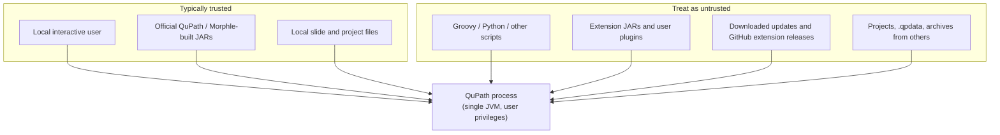

# Security Policy

This document describes the security posture, threat model, and operational
guidance for **QuPath** in this repository (including the **Morphle** build
integration described in [README.md](README.md)). It is informed by review of
this codebase and widely adopted secure-development and healthcare-imaging
practices. It is **not** a guarantee of compliance with HIPAA, GDPR, or other
regulations; use it together with your organization's policies and risk
assessments.

QuPath is **academic research software** distributed under GPLv3. It runs as a
**desktop thick client** on the user's machine with the **same privileges as the
logged-in user**. It is not a multi-tenant hosted service and does not provide
built-in authentication, encryption-at-rest for projects, or centralized audit
logging.

---

## Supported versions

| Line | Source | Security support |
|------|--------|------------------|
| Upstream [qupath/qupath](https://github.com/qupath/qupath) releases | Official builds | Follow upstream advisories and releases |
| This fork (Morphle JAR build) | Built locally via Gradle/`jpackage` per README | Security fixes land here when merged from upstream or patched in this repo |

When reporting vulnerabilities, state **whether the issue affects upstream
QuPath, this fork only, or both**, and the **commit or release** you tested.

---

## Reporting a vulnerability

**Do not** open public GitHub issues for exploitable security flaws.

Report privately using one of the following:

1. **GitHub private vulnerability reporting** (if enabled on this repository):
   open the repository **Security** tab → **Report a vulnerability**.
2. **Upstream QuPath**: for issues in shared QuPath core code, also report to
   [qupath/qupath](https://github.com/qupath/qupath) if this fork does not own
   the fix.
3. **Morphle / organization contact**: if private reporting is not configured
   here, contact your Morphle security or engineering channel (do not post
   exploit details in public channels).

### What to include

- Affected version(s), module(s), and file paths if known
- Step-by-step reproduction on Linux/macOS/Windows as applicable
- Impact (confidentiality, integrity, availability) and realistic attacker model
- Proof-of-concept if available (keep it minimal)
- For Morphle deployments: whether the issue affects the **headless JAR driver**
  (`qupath-app.jar`, `qupath-core.jar`, `qupath-core-processing.jar`) or GUI-only paths

### What to expect

Targets (may vary by maintainer capacity):

| Stage | Target |
|-------|--------|
| Acknowledgment | 5 business days |
| Initial triage | 14 business days |
| Fix for critical issues | Coordinated disclosure; aim for patch within 60 days of public disclosure where feasible ([OpenSSF best practices](https://www.bestpractices.dev/en/criteria)) |

We follow **coordinated disclosure**: please avoid public disclosure until a fix
is available, unless we agree otherwise. Reporters who wish to be credited will
be named in the advisory unless they request anonymity.

### Out of scope

- Denial of service from opening extremely large whole-slide images on
  under-provisioned hardware (resource limits are an operator concern)
- Social engineering of end users
- Vulnerabilities in **third-party** libraries without a demonstrated QuPath
  integration flaw (report to the upstream library; we track dependency updates)
- Issues requiring physical access to an already-unlocked workstation, unless
  QuPath elevates privileges (it does not)
- Missing code signing / notarization on macOS or Windows installers (known
  upstream limitation; supply-chain risk is documented below)

---

## Security model and trust boundaries



| Boundary | Behavior |
|----------|----------|
| **User ↔ application** | No application-level login; OS account controls access |
| **Application ↔ filesystem** | Read/write anywhere the user can access (projects, exports, extensions directory) |
| **Application ↔ network** | Optional HTTPS to GitHub API for update/extension checks; no mandatory cloud backend |
| **Application ↔ native code** | OpenSlide, Bio-Formats, OpenCV/JNA load native libraries from the install path |
| **Scripts & extensions** | **Full JVM capability** within the user account—not a sandbox |

**Design intent:** QuPath prioritizes research flexibility (scripting, plugins,
batch processing) over confinement. **Assume any script or extension JAR is
equivalent to running arbitrary code.**

---

## Security-relevant architecture (this repository)

The following behaviors are **observable in code** and matter for threat
modeling and hardening decisions.

### 1. Scripting (Groovy and other engines)

- Scripts run via `javax.script` (`DefaultScriptLanguage`, `QuPathGUI.runScript`).
- The default Groovy environment exposes QuPath APIs (`QP`, `QPEx`, ImageJ
  bridges, etc.) with **no process isolation**.
- **Guidance:** Only run scripts from trusted authors. Do not open project
  workflows that auto-run untrusted scripts on shared machines.

*Aligns with:* [Apache Groovy threat model](https://github.com/apache/groovy/blob/master/THREAT_MODEL.md), [OWASP CodeQL Groovy injection](https://codeql.github.com/codeql-query-help/java/java-groovy-injection/).

### 2. Extension loading

- `ExtensionClassLoader` loads **every `.jar`** under the user extensions
  directory (walk depth 3, `FOLLOW_LINKS`), adding URLs to the application
  classloader.
- Extensions can be installed via UI download from GitHub release URLs
  (`ExtensionControlPane`).
- **Guidance:** Restrict write access to the extensions directory; verify JAR
  hashes and sources; prefer building extensions from source in CI.

### 3. Java deserialization (`.qpdata` and related)

- `PathIO.createObjectInputStream()` sets an `ObjectInputFilter` that allows
  serialization of `java.base` types and classes in packages starting with
  `qupath.lib`, loaded from bootstrap/platform/system classloaders.
- A global JVM-wide filter is **not** set (see commented `ObjectInputFilter.Config` in `PathIO`).
- GeoJSON and JSON server metadata reduce reliance on Java serialization for
  newer workflows.
- **Risk:** Opening **malicious or tampered** `.qpdata` / serialized objects from
  untrusted sources may still cause denial-of-service or logic abuse; filter
  bypasses and gadget chains are an ongoing concern for any Java serialization
  ([CWE-502](https://cwe.mitre.org/data/definitions/502.html)).

*Aligns with:* [OWASP Deserialization Cheat Sheet](https://cheatsheetseries.owasp.org/cheatsheets/Deserialization_Cheat_Sheet.html), [Oracle Java serialization filters](https://docs.oracle.com/en/java/javase/21/docs/api/java.base/java/io/ObjectInputFilter.html).

### 4. Archive and project I/O

- QuPath reads zip-based formats and uses `FileSystems.newFileSystem` for some
  operations. Operators should assume **path traversal (Zip Slip)** and **zip
  bomb** risks when ingesting archives from untrusted parties unless entry paths
  and sizes are validated ([CERT IDS04-J](https://cmu-sei.github.io/secure-coding-standards/sei-cert-oracle-coding-standard-for-java/rules/input-validation-and-data-sanitization-ids/ids04-j/)).

### 5. Network use

- `UpdateChecker` calls `https://api.github.com/repos/{owner}/{repo}/releases`
  with owner/repo validated by pattern.
- Extension download uses HTTPS GitHub release URLs.
- **Guidance:** Use corporate TLS inspection policies as required; block outbound
  traffic on isolated analysis VLANs if updates are not needed.

### 6. Native libraries and supply chain

- OpenSlide and Bio-Formats bridge to **native** parsers; vulnerabilities in
  those stacks affect QuPath when parsing malicious slide files.
- Build pipeline (`.github/workflows/gradle.yml`) validates the Gradle wrapper and
  builds on CI for multiple OS targets.
- Official QuPath releases have historically used **ad-hoc macOS signing**; verify
  artifacts by hash and trusted build provenance when deploying Morphle JARs
  ([qupath#1672](https://github.com/qupath/qupath/issues/1672)).

### 7. Morphle integration

Per [README.md](README.md), Morphle builds JARs with Java 21 and ships them to a
driver repository:

```bash
./gradlew -Dorg.gradle.java.home=/usr/lib/jvm/java-1.21.0-openjdk-amd64/ clean jpackage
```

Artifacts: `qupath-app/build/libs/`, `qupath-core/build/libs/`,
`qupath-core-processing/build/libs/` (renamed when copied to the driver).

**Morphle-specific recommendations:**

- Build JARs in a **controlled CI environment**; record Gradle version, JDK hash,
  and git commit in release notes.
- Distribute JARs over **integrity-protected channels** (signed object storage,
  internal package registry).
- Run the driver under a **dedicated service account** with least privilege on
  slide storage paths.
- Do not mix production PHI paths with internet-facing hosts running untrusted
  scripts.

---

## Operational security for digital pathology and PHI

QuPath may process **whole-slide images (WSI)** and annotations that contain or
relate to **protected health information (PHI)**. The application does not
automatically de-identify data.

| Topic | Recommendation |
|-------|----------------|
| **Regulatory framing** | If PHI is involved, perform a **risk analysis** and document administrative, physical, and technical safeguards ([HIPAA Security Rule summary](https://www.hhs.gov/hipaa/for-professionals/security/laws-regulations/index.html)). |
| **De-identification** | Remove label images, macro/overview regions with identifiers, filenames, and DICOM/metadata fields before sharing data for research ([privacy risks in WSI sharing](https://pmc.ncbi.nlm.nih.gov/articles/PMC10160114/)). |
| **Storage** | Encrypt disks hosting slide libraries and QuPath projects; restrict ACLs to role-based groups ([ACR/SIIM radiology security guidance](https://doi.org/10.1016/j.jacr.2025.07.014)). |
| **Network** | Segment pathology workstations from general office networks ([NIST SP 1800-24 PACS practices](https://nvlpubs.nist.gov/nistpubs/SpecialPublications/NIST.SP.1800-24.pdf)). |
| **Audit** | Use OS-level logging and document who exports measurements or images; QuPath is not a system of record for HIPAA audit controls. |
| **Backups** | Protect backup media containing projects (`.qpproj`, `.qpdata`) with the same classification as source slides. |

---

## Guidance for end users

1. **Install from trusted sources** — Official [QuPath releases](https://github.com/qupath/qupath/releases) or Morphle-built JARs from your organization only.
2. **Patch** — Track upstream QuPath security releases and rebuild Morphle JARs promptly.
3. **Scripts** — Treat `.groovy` scripts like executables; review before batch-running on servers.
4. **Extensions** — Install only signed-off extensions; remove unknown JARs from the extensions folder.
5. **Projects from others** — Open foreign `.qpproj` / `.qpdata` in a VM or non-production account when possible.
6. **Shared machines** — Log out of the OS session; QuPath has no separate logout.
7. **Screen captures & exports** — Exported PNG/GeoJSON/measurement tables may still contain sensitive metadata; review before emailing or uploading.

---

## Guidance for developers and maintainers

This fork inherits QuPath's Java/JavaFX modular layout (`qupath-core`,
`qupath-gui-fx`, extensions, Gradle version catalog). Align changes with:

| Framework | Use |
|-----------|-----|
| [OWASP Java Security Cheat Sheet](https://cheatsheetseries.owasp.org/cheatsheets/Java_Security_Cheat_Sheet.html) | Input validation, crypto, logging |
| [Oracle Secure Coding Guidelines for Java SE](https://www.oracle.com/java/technologies/javase/seccodeguide.html) | Serialization, privilege, trust boundaries |
| [OWASP TCASVS](https://github.com/OWASP/TCASVS) (thick client chapters) | File import, IPC, dynamic code |
| [NIST SSDF SP 800-218](https://nvlpubs.nist.gov/nistpubs/SpecialPublications/NIST.SP.800-218.pdf) | Organizational SDL practices |
| [OpenSSF Best Practices](https://www.bestpractices.dev/en/criteria) | Vulnerability response, CI hygiene |
| [SLSA](https://slsa.dev/) | Build provenance goals for Morphle artifacts |

### Priority hardening opportunities (non-exhaustive)

- Strengthen `ObjectInputFilter` with **depth / reference / stream byte limits**
  and consider `rejectUndecidedClass` semantics ([OWASP deserialization guidance](https://cheatsheetseries.owasp.org/cheatsheets/Deserialization_Cheat_Sheet.html)).
- Document and optionally warn when loading extensions from **writable** paths.
- Add **Zip Slip** and size guards anywhere user-supplied zip/jar content is extracted.
- Run **dependency scanning** (Gradle lockfile / OSS Review Toolkit) on each release.
- Add **SAST** (SpotBugs, CodeQL) to CI for pull requests.
- For untrusted script scenarios, consider **out-of-process** script runners (no
  in-JVM sandbox is considered sufficient for Groovy).

### Secure code review checklist for PRs

- [ ] No new deserialization of untrusted types without filters and tests
- [ ] File paths normalized (`Path.normalize()`) before use with user-influenced names
- [ ] No `Runtime.exec` / `ProcessBuilder` with unvalidated input
- [ ] Network fetches use HTTPS with pinned expectations where feasible
- [ ] Secrets not committed (API keys, tokens, patient identifiers in tests)
- [ ] Native/JNA boundaries documented when parsing new formats

---

## Dependency and vulnerability management

- Track [QuPath changelog](https://github.com/qupath/qupath/blob/master/CHANGELOG.md) and GitHub Security Advisories on upstream.
- Monitor CVEs in **Bio-Formats**, **OpenSlide**, **OpenCV/JavaCPP**, **JavaFX**, and **Groovy**.
- CI validates the Gradle wrapper (`gradle/wrapper-validation-action`) on pull requests.
- For Morphle: regenerate JARs after dependency bumps and smoke-test the driver.

---

## References

The policy above synthesizes guidance from the following sources (and related
material), plus direct review of this repository:

1. [OWASP Java Security Cheat Sheet](https://cheatsheetseries.owasp.org/cheatsheets/Java_Security_Cheat_Sheet.html)
2. [Oracle Secure Coding Guidelines for Java SE](https://www.oracle.com/java/technologies/javase/seccodeguide.html)
3. [OWASP Thick Client Application Security Verification Standard (TCASVS)](https://owasp.org/projects/thick-client-application-security-verification-standard)
4. [OWASP Desktop App Security Top 10](https://owasp.org/projects/desktop-app-security-top-10)
5. [OWASP Deserialization Cheat Sheet](https://cheatsheetseries.owasp.org/cheatsheets/Deserialization_Cheat_Sheet.html)
6. [OWASP Web Security Testing Guide – Insecure Deserialization](https://wstg.owasp.org/latest/4-Web_Application_Security_Testing/07-Injection/23-Insecure_Deserialization/)
7. [OWASP Developer Guide – Validate All Inputs](https://devguide.owasp.org/en/04-design/02-web-app-checklist/05-validate-inputs/)
8. [CWE-502: Deserialization of Untrusted Data](https://cwe.mitre.org/data/definitions/502.html)
9. [CERT IDS04-J: Safe ZipInputStream extraction](https://cmu-sei.github.io/secure-coding-standards/sei-cert-oracle-coding-standard-for-java/rules/input-validation-and-data-sanitization-ids/ids04-j/)
10. [CodeQL: Java Zip Slip](https://codeql.github.com/codeql-query-help/java/java-zipslip/)
11. [CodeQL: Groovy injection](https://codeql.github.com/codeql-query-help/java/java-groovy-injection/)
12. [Apache Groovy THREAT_MODEL.md](https://github.com/apache/groovy/blob/master/THREAT_MODEL.md)
13. [GitHub: Adding a security policy (SECURITY.md)](https://docs.github.com/en/code-security/how-tos/report-and-fix-vulnerabilities/configure-vulnerability-reporting/add-security-policy)
14. [Safeguard.sh: Writing a usable SECURITY.md](https://safeguard.sh/resources/blog/write-a-security-md-for-your-open-source-repo)
15. [OpenSSF Best Practices Badge criteria](https://www.bestpractices.dev/en/criteria)
16. [OpenSSF: Keys to improved software security](https://openssf.org/blog/2024/05/13/unlock-the-keys-to-improved-software-security/)
17. [NIST SP 800-218 (SSDF) v1.1](https://nvlpubs.nist.gov/nistpubs/SpecialPublications/NIST.SP.800-218.pdf)
18. [SLSA framework](https://slsa.dev/)
19. [CISA SSDF resource page](https://www.cisa.gov/resources-tools/resources/nist-sp-800-218-secure-software-development-framework-v11-recommendations-mitigating-risk-software)
20. [HIPAA Security Rule summary (HHS)](https://www.hhs.gov/hipaa/for-professionals/security/laws-regulations/index.html)
21. [ACR/SIIM: Protecting radiology data against cyber threats (2025)](https://doi.org/10.1016/j.jacr.2025.07.014)
22. [NIST SP 1800-24: Securing PACS](https://nvlpubs.nist.gov/nistpubs/SpecialPublications/NIST.SP.1800-24.pdf)
23. [Privacy risks of whole-slide image sharing](https://pmc.ncbi.nlm.nih.gov/articles/PMC10160114/)
24. [QuPath upstream repository](https://github.com/qupath/qupath) and [issue #1672 (code signing)](https://github.com/qupath/qupath/issues/1672)
25. [Linux Foundation Insights – QuPath project health](https://insights.linuxfoundation.org/project/qupath-qupath/security)
26. [Academy Software Foundation – SECURITY.md practices](https://tac.aswf.io/best_practices/security.html)
27. [OpenSSF Secure Coding Guide – safe archive extraction (pyscg-0012)](https://best.openssf.org/Secure-Coding-Guide-for-Python/04_neutralization/pyscg-0012/)

---

## License

This security policy document is provided as part of the QuPath project materials
in this repository. QuPath is licensed under GPLv3; see [LICENSE](LICENSE).
